# ASYNC: Udyam Digital

A local prototype for the Airtel SYNC Enterprise Track A brief: business needs, a configurable estimate, consented document checks, demo checkout and saved order tracking. Accel Business and the supplied customer data are fictional.

**Spicers | TIET:** Ishan Bhat and Gaurav Prakash Srivastava. [Watch the recorded demo](https://youtu.be/VdtKxBKpCHQ) or open the [final seven-slide submission files](submission/final/README.md). Supporting architecture and one-page privacy PDFs are included there. The repository and supporting PDFs are publicly accessible.

The redesigned frontend has a visible **Create account** entry, guided registration, a clearer business/service workspace and drag-and-drop document uploads. See [frontend and registration](docs/FRONTEND.md) for the interaction changes and keyboard/mobile checks.

For teammate testing, fixes and final submission work, follow the [teammate acceptance checklist](docs/TEAMMATE_CHECKLIST.md). It covers every feature, expected results, live extraction/voice checks and the required handback evidence.

Follow-up chat, account security, Hindi operations, partner/voice flows and the disabled WhatsApp guided channel are documented in [operations instructions](docs/OPERATIONS.md). See [synthetic business evidence](docs/BUSINESS_EVIDENCE.md) for reproducible segment analysis. [Submission notes](submission/README.md) distinguish the final team video from the controlled rehearsal and describe the branded deck, architecture, privacy PDF and clean source archive.

For a successful checkout test, use the [separately labelled DEMO01 development documents](demo_documents/checkout/README.md). They match the supplied mock registries; generation makes no provider calls, and live extraction still needs testing. The supplied K01-K12 files remain unchanged and contain Udyam inconsistencies or missing identifiers/documents that prevent an unchanged passing set under the current checks.

The [milestone plan](docs/MILESTONES.md) tracks implemented account/dashboard/voice work, remaining live checks, access-dependent WhatsApp integration and submission deliverables. Planned features are separate from the implemented milestones below.

## Prerequisites

| Requirement | Version / purpose |
| --- | --- |
| Git | Clone the repository and share changes |
| Python | **3.12**, with `pip` and `venv` |
| Node.js | **22.x** with npm; tested with Node 22.23.2 |
| Browser | A current browser; microphone support varies by browser/device |
| Internet | First-time dependency installation and optional provider requests |
| Gemini API key | Required for advisor drafting and document extraction; guided discovery and estimates work without it |

No separate database server, Docker installation or paid hosting is needed for local use. SQLite is included with Python. Anyone can clone the public repository using the URL below.

## Quick start on Windows

Open PowerShell and run:

```powershell
git clone https://github.com/Mickeyzer/ASYNC.git
cd ASYNC
py -3.12 -m venv .venv
.\.venv\Scripts\python.exe -m pip install -r requirements.txt
Copy-Item .env.example .env
```

For advisor/document extraction, open the new `.env` file locally and fill in `GEMINI_API_KEY`. Keep `GEMINI_MODEL=gemini-3.5-flash-lite` unless your account requires a different supported model. Do not put a key in browser code or commit `.env`. An existing environment variable takes precedence over `.env`.

Start the app:

```powershell
.\run.cmd
```

Open **http://127.0.0.1:8010**. The launcher automatically uses `.venv` when present, installs missing frontend dependencies, builds React/TypeScript with Vite, and starts FastAPI. No virtual-environment activation or PowerShell execution-policy change is needed. If `py` is unavailable, use a Python 3.12 `python` command to create the virtual environment instead.

Click **Create account** in the header. Choose a username of 3 to 40 characters, a password of at least 12 characters, and confirm it. Each local checkout has its own accounts and records; teammates do not inherit someone else's login. Use fictional details and the supplied synthetic documents.

Stop the server with **Ctrl+C**. For later runs, open PowerShell in `ASYNC` and run `.\run.cmd` again. After pulling changes, update Python dependencies if needed, rebuild frontend dependencies when the lockfile changes, then restart:

```powershell
git pull
.\.venv\Scripts\python.exe -m pip install -r requirements.txt
npm.cmd ci --prefix frontend --cache .npm-cache --ignore-scripts --no-audit --no-fund
.\run.cmd
```

## macOS / Linux

After installing Git, Python 3.12 and Node 22:

```bash
git clone https://github.com/Mickeyzer/ASYNC.git
cd ASYNC
python3.12 -m venv .venv
source .venv/bin/activate
python -m pip install -r requirements.txt
cp .env.example .env
npm ci --prefix frontend --ignore-scripts --no-audit --no-fund
npm run build --prefix frontend
python -m uvicorn backend.main:app --host 127.0.0.1 --port 8010 --no-access-log
```

Configure your own Gemini key in `.env` when needed and open the same localhost URL. The automated CI configuration targets Linux; the documented local walkthrough was checked on Windows.

## Development and troubleshooting

- **Frontend development:** keep the backend running on port 8010, then run `npm.cmd run dev --prefix frontend` in a second terminal. Open the Vite URL it prints; API calls proxy to FastAPI.
- **PowerShell blocks npm:** use `npm.cmd`, as shown above.
- **Python commands in linked guides:** use `.\.venv\Scripts\python.exe` in place of `python` when you have not activated the environment.
- **Port 8010 is busy:** stop an old app instance first. Restarting also loads backend changes; the normal launcher does not auto-reload Python.
- **Advisor unavailable:** guided discovery still works. Run `.\.venv\Scripts\python.exe check_gemini.py` for redacted provider diagnostics. Missing credentials, quota, network failures and timeouts are distinct; do not assume a failed request means the key is invalid.
- **Document checks fail:** some supplied applicants intentionally have missing, inactive or inconsistent evidence. Review the reported reason; do not force approval.
- **Repository clone fails:** check the repository URL, Git installation and network access. The repository is public and does not require an invitation. Never paste an access token into a clone URL.

`runtime/accounts.sqlite3` holds local accounts; `runtime/onboarding.sqlite3` holds local document-check/order records. Runtime data, credentials, dependencies, caches and personal learning notes are excluded from Git. The supplied CSVs and fictional KYC images are included. Generated presentation/privacy/architecture files and the controlled demo are in `submission/`; rebuild the optional source ZIP with `python scripts/package_source.py`.

## First milestone

- Guided discovery: business type, city tier, employees, locations, current internet, budget, registration claim and needs.
- Optional Gemini discovery: a consented description becomes a structured draft. Review/edit the form, check **I have reviewed the current answers below**, then send a follow-up reply. The draft keeps earlier reviewed fields when later answers omit them. A bounded recent conversation stays in the open tab; failures preserve the form and retry text. It never verifies eligibility or supplies authoritative prices.
- Backend recommendations grounded in the 25 supplied products, with required companion products included.
- Editable quantities, add/remove services, itemised monthly and setup costs, per-product contract terms, budget warnings and a downloadable text estimate.
- Conditional suggestions remain visible. Known failures are ineligible. The backend rechecks the bundle before marking catalogue checks passed.
- Optional synthetic GSTIN lookup, with explicit consent, checksum validation accepting the dataset's PAN entity character `X`, masked results and expiring server-owned evidence.
- English and Hindi interface, explanations and eligibility messages. Catalogue product names and original descriptions are retained in English.

Passing catalogue checks does not establish that a business is fully verified. The second milestone continues the estimate into the document and demo order flow below.

## Second milestone: documents to a demo order

Restart the server with `run.cmd` after updating; `/api/health` reports version `0.7.0`. The running Python process does not reload backend changes automatically.

1. Use **Create account** or **Sign in** in the header. Registration asks for a username, password and password confirmation. You can explore first and register when continuing to document checks; your selected estimate stays in place. Review an estimate and choose **Continue to document checks**. A GSTIN-only conditional bundle can also continue from its requirements message; final submission still rechecks eligibility using the document evidence.
2. Read and accept the KYC consent notice. Reopen account-linked records from the Account menu. Older unclaimed records require their private code through **Resume a saved check or order** before linking to your account.
3. Upload PNG/JPEG images, up to 5 MB each, into the GST, Udyam, signatory ID and address-proof slots. Use documents from one applicant in `YTL_TrackA_Udyam_Digital_Data/kyc_documents/`, for example a common `Kxx_` prefix. Several supplied applicants have deliberately missing, unclear or inconsistent documents; these must not automatically pass.
4. Review the masked extracted fields, confirm the business name/address and signatory, then run the checks. Missing or invalid evidence requires action; ambiguous text or inconsistent names/addresses requires correction or review. Replace documents to retry. An authorized reviewer can confirm legibility-only ambiguity after checking originals; other failed checks require correction.
5. When checks pass, accept the displayed prices/contracts and acknowledge the simulation. **Create demo order** saves one order; retrying submission returns the same order.
6. View status and per-service expected dates. **Simulate next stage** explicitly advances accepted → installation scheduled → activated. Account-linked records reopen after a browser refresh or server restart, until expiry. The delete action removes the local record and retained fields.

The backend checks GSTIN format/checksum and active registry status; Udyam format/lookup; registry and cross-document names/addresses/dates; signatory ID expiry; and address-proof age of 0–90 days, inclusive, using **2026-07-15**. Udyam district code `00` and GSTIN PAN entity character `X` support the supplied synthetic data. Matching normalizes Unicode, case, spaces and punctuation; other differences require review rather than a fuzzy automatic approval. All four document types are required by this demo policy. Applicants without them need follow-up; they are not automatically approved.

Dates in the tracker use the same labelled demo calendar. Bundle ETA is the maximum of the selected products' `typical_install_days`, assuming parallel planning. No payment, actual address-level availability check, installation, activation, identity proof or signatory-authority verification occurs.

## Demo assumptions

1. Monthly unit rates use `price_min_inr_per_month`. This is a reproducible demo policy, not a real commercial offer. The supplied price range is retained in the API.
2. Setup fees apply per purchased unit. Taxes are not calculated or included. First-month estimate = monthly services + one-time setup.
3. Contract terms remain attached to each product; the application does not invent a single bundle contract or a contract-wide total.
4. Initial quantities are one site-based unit, camera or counter per site; one email licence, device or mobile line per employee. Customers can edit them. Added catalogue items start at one unit.
5. Recommendations are a transparent starting bundle for selected needs, not a mathematically optimal budget allocation. If the bundle exceeds budget, the difference is shown. The app does not silently drop a requested capability to meet a budget.
6. City tiers are supplied by the demo lead. Address-level installation availability is not available in the dataset and is not inferred from a city tier.
7. Compatible connections must be in the same proposed bundle, as the dataset requires. A customer's existing internet connection does not satisfy that rule automatically.

## Gemini

The server reads `GEMINI_API_KEY` and optional `GEMINI_MODEL` from its environment or a root `.env` file based on `.env.example`. Existing environment variables take precedence. The default model is `gemini-3.5-flash-lite`. The configuration stays on the server; keep credentials out of browser code, documents and Git.

The implementation uses the [Google Gen AI SDK's structured response support](https://googleapis.github.io/python-genai/) and validates returned drafts with Pydantic. Discovery sends the consented description, up to eight recent conversation entries and any explicitly reviewed business facts. Conversation history is not stored by the backend. Document extraction separately sends the consented image after metadata removal and size validation. Filenames, registry records and pricing data are not sent with document extraction. Product eligibility, registry comparisons and quote arithmetic stay on the backend.

When a key is missing, the provider is unreachable or its response fails validation, the page explains the failure in English or Hindi and offers the guided form while preserving the description. Network restrictions, timeouts, access errors, unavailable models, quota limits and invalid output have separate safe diagnostics. Each explicit request uses one bounded attempt. Live generation remains unverified in the restricted implementation environment; controlled tests cover successful extraction and failure handling.

On November 1, a user-run check returned a valid structured advisor draft using `gemini-3.5-flash-lite` in 4.5 seconds. The previous `gemini-flash-latest` alias timed out even for plain text after 61.3 seconds. This establishes a working model for that terminal and request; it does not establish the cause of the alias timeout or ongoing availability. Direct calls from the restricted implementation environment remain blocked. To check access from your normal PowerShell terminal:

```powershell
.\.venv\Scripts\python.exe check_gemini.py
```

It sends one short synthetic request and prints only safe diagnostics, including numeric HTTP status and elapsed time. Each attempt allows 60 seconds; the SDK forwards this timeout as a server deadline too. HTTP 504 is reported as a timeout, while other server failures retain their own category. Start `run.cmd` from that terminal and try the language advisor. If an existing environment variable selects the old alias, set `$env:GEMINI_MODEL = "gemini-3.5-flash-lite"` before starting. Provider HTTP statuses such as 403 (permission/access), 404 (resource/model) and 429 (quota/rate limits) require different remedies; see [Google's troubleshooting guide](https://ai.google.dev/gemini-api/docs/troubleshooting). The checker never prints the key or raw exception.

If a 504 persists at 60 seconds, isolate the request instead of increasing the deadline again:

```powershell
.\.venv\Scripts\python.exe check_gemini.py --plain
.\.venv\Scripts\python.exe check_gemini.py --model gemini-3.5-flash-lite
```

The first command tests basic text generation on the configured model without the advisor schema or instructions. The second explicitly selects the model that succeeded in the user-run check (now also the default). Each sends one synthetic request. `--model` only affects that invocation, and `--plain` success does not establish that structured extraction works. Compare the reported model, check type, status and elapsed time. [Gemini 3.5 Flash-Lite](https://ai.google.dev/gemini-api/docs/models/gemini-3.5-flash-lite) supports structured output; access must be checked when using a different project. Generated text and raw errors are never printed. The advisor leaves temperature at the provider default for compatibility across model versions.

## Design

```mermaid
flowchart LR
    A[Business description] -->|Explicit consent| G[Gemini: draft needs]
    G --> B[Owner reviews business details]
    F[Guided form] --> B
    B --> R[Backend recommendations]
    C[Product catalogue CSV] --> R
    R --> E[Eligibility and dependencies]
    V[Mock registry lookup] --> T[Expiring evidence token]
    T --> E
    E --> Q[Backend quote arithmetic]
    Q --> U[Edit bundle and quantities]
    U --> E
    U --> K[Recheck catalogue requirements]
    K --> X[Reviewed estimate; full KYC remains]
    X --> S[Customer account and separate KYC consent]
    S --> D[Upload document images]
    D --> O[Gemini extracts fields]
    O --> H[Owner reviews details]
    H --> V2[Backend registry and consistency checks]
    V2 -->|Missing or conflicting evidence| D
    V2 -->|Ambiguous fields| RV[Authorized reviewer; revision-bound decisions]
    S -->|Separate follow-up consent| P[Assigned partner dashboard]
    RV -->|Corrected evidence or confirmed legibility| V2
    V2 -->|Checks pass| A2[Accept estimate and simulation]
    A2 --> R2[Recheck eligibility and prices]
    R2 --> DB[(SQLite demo order and events)]
    DB --> TR[Recoverable simulated tracker]
```



`backend/eligibility.py` applies the rules. `backend/recommendations.py` constructs starting bundles. `backend/quotes.py` owns prices and totals. `backend/verification.py` creates server-owned evidence. `backend/advisor.py` is the optional language adapter. `frontend/` is the responsive interface.

The frontend uses React 19, TypeScript and Vite. `Account.tsx`, `Operations.tsx` and `VoiceInput.tsx` add identity, assigned work and reviewed browser speech. `backend/accounts.py` owns local credentials/sessions, `operations.py` enforces staff access, `limits.py` bounds work and `lead_analysis.py` produces aggregate synthetic evidence. Staff provisioning uses `scripts/manage_accounts.py`; no staff passwords ship with the app. `frontend/src/App.tsx` owns discovery/quote state; `Onboarding.tsx` owns consent, upload, checkout and tracking. `backend/kyc.py` extracts and checks documents; `onboarding.py` enforces transitions; `onboarding_store.py` stores expiring records in `runtime/onboarding.sqlite3` (gitignored). Python's SQLite library avoids another database service. `UDYAM_DB_PATH` can override the database path for isolated tests. Run one server worker because raw extracted fields and preliminary GSTIN evidence are in process memory.

## API

| Endpoint | Purpose |
| --- | --- |
| `GET /api/health` | Liveness, version and catalogue count |
| `GET /api/ready` | Validate supported database schemas/storage; does not call providers |
| `GET /api/catalogue` | Products and demo pricing policy |
| `POST /api/discover` | Consented language-assisted draft |
| `POST /api/recommend` | Suggested bundle and product eligibility |
| `POST /api/quote` | Recalculate a selected bundle |
| `POST /api/quote/check` | Recheck requirements; returns 409 if unresolved |
| `POST /api/gstin/verify` | Consented synthetic registry lookup |
| `POST /api/onboarding` | Consent plus a server-priced draft and private access code |
| `GET /api/onboarding/{id}` | Resume document checks or read the tracker |
| `POST /api/onboarding/{id}/documents/{kind}` | Raw PNG/JPEG body; extract document fields |
| `POST /api/onboarding/{id}/check` | Confirm details and run deterministic document/registry checks |
| `POST /api/onboarding/{id}/submit` | Accept the estimate and create an idempotent demo order |
| `POST /api/onboarding/{id}/advance` | Explicit simulated transition with expected current status |
| `DELETE /api/onboarding/{id}` | Withdraw local processing consent and delete the record |
| `POST /api/account/register`, `/login`, `/logout` | Customer registration and revocable sessions; public registration cannot grant staff roles |
| `GET /api/account/me`, `DELETE /api/account` | Current user or account/local-record deletion |
| `POST /api/account/password` | Verify current password, change it and rotate/revoke sessions |
| `GET`, `DELETE /api/account/sessions` | List own active sessions or revoke all other sessions |
| `DELETE /api/account/sessions/{id}` | Revoke an owned session; opaque public ID, never a token/hash |
| `GET /api/onboarding` | Current customer record list |
| `POST /api/onboarding/{id}/claim` | Claim a legacy unowned record with its private code |
| `POST`, `DELETE /api/onboarding/{id}/handoff` | Separate consented follow-up request/withdrawal |
| `GET /api/operations/leads`, `/partners` | Authorized task queue and reviewer-only partner list |
| `GET /api/operations/{id}` | Scoped task detail; partner view omits document fields |
| `POST /api/operations/{id}/assign`, `/decision` | Revision-checked assignment and controlled decisions |
| `GET /api/operations/metrics/summary`, `/insights/summary` | Reviewer-only aggregate events and synthetic historical evidence |
| `GET /api/operations/channel-status` | Reviewer-only inbound/outbound configuration status; no credential disclosure |
| `GET`, `POST /api/integrations/whatsapp/webhook` | Signed, deduplicated ingress; separately gated bilingual guided replies, corrections, STOP and public web handoff |
| `GET /openapi.json` | Request and response API schema |

Clients cannot submit a verified GSTIN status or override catalogue prices. Unknown fields, unknown product IDs, duplicate products and invalid quantities are rejected. A missing dependency or unverified required GSTIN is conditional; a known rule failure takes precedence. Invalid or expired evidence is rejected.

New records require a signed-in customer and server-side ownership. A recovery code cannot authorize another account. Unowned records from the older version still accept their hashed private code in `X-Order-Key` and can be claimed by a signed-in customer presenting that code. Cookies are HttpOnly/SameSite=Strict; mutations from authenticated clients and account login/register require `X-Requested-With: Udyam` and reject cross-site origins. A preliminary GSTIN lookup token cannot establish the new record's KYC result. Replacing a document invalidates its previous approval. Order submission requires server-owned checks, reruns catalogue eligibility and rejects changed prices or contract terms.

## Verification

```powershell
.\.venv\Scripts\python.exe -m pip install -r requirements-dev.txt
.\.venv\Scripts\python.exe -m pytest -q
```

With Playwright Chromium installed, the core checks can run on their own isolated temporary server:

```powershell
.\.venv\Scripts\python.exe tests/browser_core_check.py
```

The second milestone has an isolated browser test that starts and stops its own loopback server with a temporary database and controlled extraction responses:

```powershell
.\.venv\Scripts\python.exe tests/browser_onboarding_check.py
.\.venv\Scripts\python.exe tests/browser_operations_check.py
```

Latest verification is recorded in [the actual check report](submission/verification-report.json), including backend test count, TypeScript/build and all isolated browser scenario groups. Checks cover registry/date/mismatch failures, access isolation, metadata removal, payload limits, document replacement, checkout gating, price changes, restart recovery, duplicate submission, deletion, Hindi and mobile layouts. All 47 supplied images pass image decoding/preprocessing; this does not measure OCR accuracy. Provider extraction tests intercept SDK HTTP responses; live image extraction still needs a run from a network-enabled normal terminal. The advisor's live text path was separately confirmed by the user. No judges-only answer key was used.

Screenshots and downloaded examples are in the ignored `artifacts/` directory. If Chromium is missing, install it with `python -m playwright install chromium` on a network-enabled machine.

## Privacy and prototype limits

- The form does not require a name, phone number, documents or a GSTIN to explore bundles. No third-party analytics or localStorage/sessionStorage is used. Account access uses an HttpOnly cookie; daily aggregate event counts omit customer IDs and document values.
- API responses avoid echoing invalid input; the startup command disables access logs. Raw registry identifiers are not stored in verification tokens or returned unmasked.
- Verification evidence contains only a registry status and expiry. It lives in one server process for at most 30 minutes and is invalid after restart. Expired entries are removed during lookup/access. Do not run multiple workers with this in-memory store.
- Document images are held only during processing, never saved by the app. Raw extracted fields stay in server memory for up to 30 minutes and are cleared when an order is submitted. Incomplete extraction is lost on restart; completed decisions/orders survive in SQLite.
- Onboarding consent, profile/estimate, masked document summaries and order events expire after 24 hours. Cleanup runs every 30 seconds while the app is running, and on startup/access. When the app is stopped, expired rows are removed on the next run. Delete removes local records and raw fields immediately; this cannot delete provider-side records.
- Account ownership controls new records. Legacy unclaimed codes remain private until linked. Accounts expire after 30 days without credential sign-in, sessions after eight hours and aggregate counters after 30 days. Account deletion removes owned local records. Databases/backups are not encrypted; local machine administrators can read them. See [privacy design](docs/PRIVACY.md).
- Loopback hosts are the default. Accounts, role restrictions, local rate limits and controlled review are implemented; this remains a synthetic-data local prototype. Public hosting still needs managed identity/recovery, HTTPS/Secure cookies, encrypted storage, proxy-origin handling, shared limits and operational/security validation. Docker/Compose and CI configuration are prepared, but container runtime and hosted CI are unverified.
- Synthetic registry status is not proof of ownership, consent to a real commercial contract, full KYC, address availability or activation readiness.

Reviewable submission assets are prepared in `submission/`. The video is explicitly a controlled rehearsal, not live OCR evidence. Final live-provider recording, repository publication and submission review remain pending. Live OCR quality across the planted problems still needs evaluation; a green mock check is not a compliance or real-world identity-verification claim.
